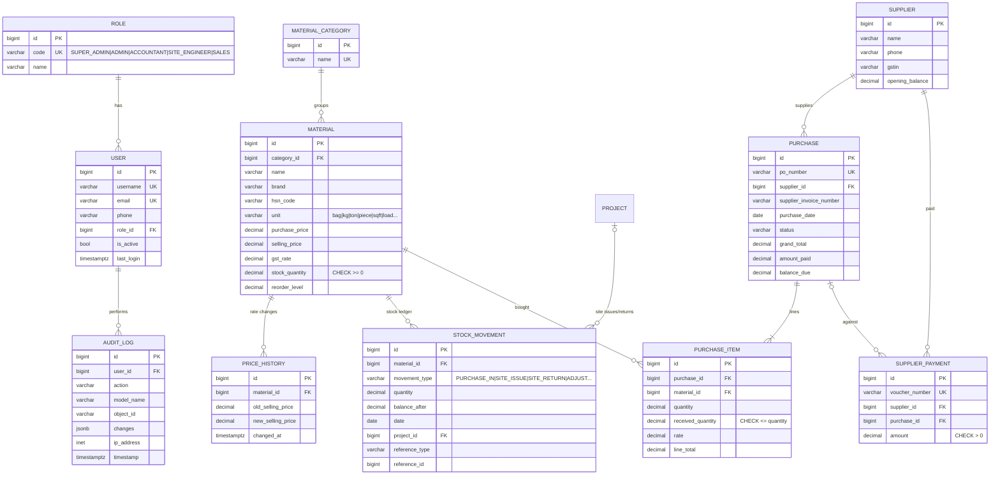
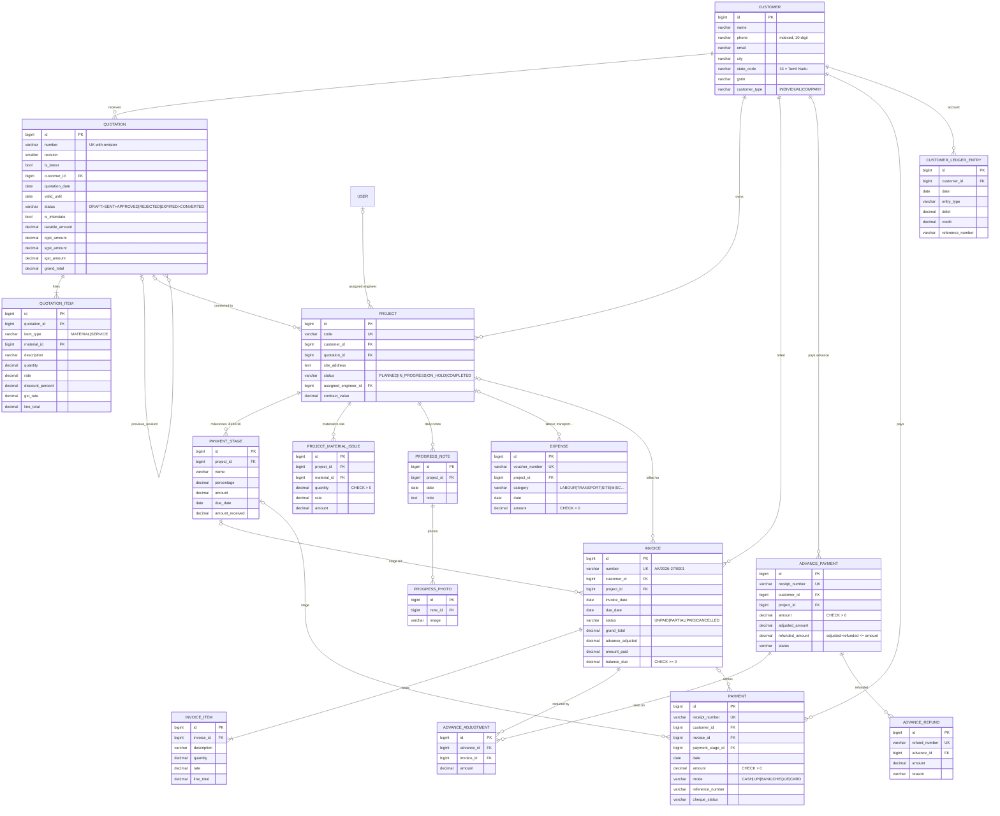

# AK Builders — Database Schema & ER Diagram

PostgreSQL 16 · BigAutoField integer primary keys · all money `Decimal(12,2)` · quantities `Decimal(12,3)`.

> Open this file in **VS Code** (with the "Markdown Preview Mermaid Support" extension) or on **GitHub** to see the diagrams rendered.

## Conventions on every business table (`BaseModel`)

| Column | Purpose |
|---|---|
| `id` | BigAutoField primary key |
| `created_at`, `updated_at` | Timestamps (Asia/Kolkata) |
| `created_by`, `updated_by` | FK → User, filled automatically from the logged-in user |
| `is_deleted`, `deleted_at`, `deleted_by` | Soft delete — default manager hides deleted rows; `all_objects` shows everything |

Every create / update / soft-delete on a `BaseModel` table writes an **AuditLog** row with a field-level diff.

---

## 1. Masters, users and stock

## 2. Sales cycle: quotation → project → invoice → payment

## 3. Settings tables

| Table | Notes |
|---|---|
| `core_companysettings` | Single row (id = 1): name, logo, address, GSTIN, state code **33 (Tamil Nadu)**, bank + UPI details, default GST %, quotation validity, invoice due days, notification switches |
| `core_documentsequence` | One row per document type per financial year. Unique `(doc_type, financial_year)`. Locked with `SELECT … FOR UPDATE` when issuing numbers |
| `core_termstemplate` | Reusable terms & conditions for quotations / invoices / receipts |
| `payments_paymentreminder` | Scheduled reminders (email / SMS / WhatsApp) for overdue invoices and stages |

## 4. Document number series

| Document | Format | Example |
|---|---|---|
| Invoice | `AK/{FY}/{0000}` | AK/2026-27/0001 |
| Quotation | `AK/QT/{FY}/{0000}` + revision | AK/QT/2026-27/0007 Rev 2 |
| Advance receipt | `AK/ADV/{FY}/{0000}` | AK/ADV/2026-27/0003 |
| Payment receipt | `AK/RCP/{FY}/{0000}` | AK/RCP/2026-27/0012 |
| Purchase order | `AK/PO/{FY}/{0000}` | AK/PO/2026-27/0004 |
| Project | `AK/PRJ/{FY}/{0000}` | AK/PRJ/2026-27/0002 |
| Expense voucher | `AK/EXP/{FY}/{0000}` | AK/EXP/2026-27/0040 |

Financial year runs April → March and numbering restarts at 0001 each April. Prefixes can be edited in Django admin → Document sequences.

## 5. Money rules built into the schema

| Rule | Where it is enforced |
|---|---|
| No float money | Every amount is `MoneyField` = `Decimal(12,2)` with a `>= 0` validator |
| Stock never below zero | DB `CHECK (stock_quantity >= 0)` + service validation (Phase 3) |
| Payment / advance / expense amount > 0 | DB `CHECK` constraints |
| Advance not over-used | DB `CHECK (amount >= adjusted_amount + refunded_amount)` |
| Invoice balance never negative (no over-payment) | DB `CHECK (balance_due >= 0)` + service check |
| Received qty ≤ ordered qty | DB `CHECK` on `PurchaseItem` |
| Unique document numbers | `UNIQUE` on every number column; quotation unique on `(number, revision)` |
| GST split | Same state as company (33) → CGST + SGST; other state → IGST (`apps/core/utils.py`) |
| Atomic financial operations | All posting services use `transaction.atomic()` (Phases 3–5) |

## 6. Customer ledger posting (Phase 5)

| Event | Debit | Credit |
|---|---|---|
| Invoice issued | grand total | |
| Advance received | | amount |
| Payment received | | amount |
| Advance adjusted on invoice | — | — (already credited when received) |
| Advance refunded | amount | |
| Invoice cancelled | | grand total |
| Cheque bounced | amount | |

**Outstanding = Σ debit − Σ credit.** A negative result means the customer has unused advance with us.
